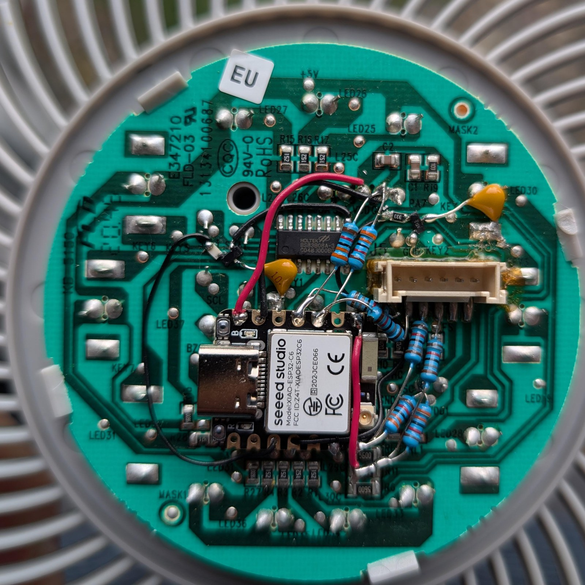
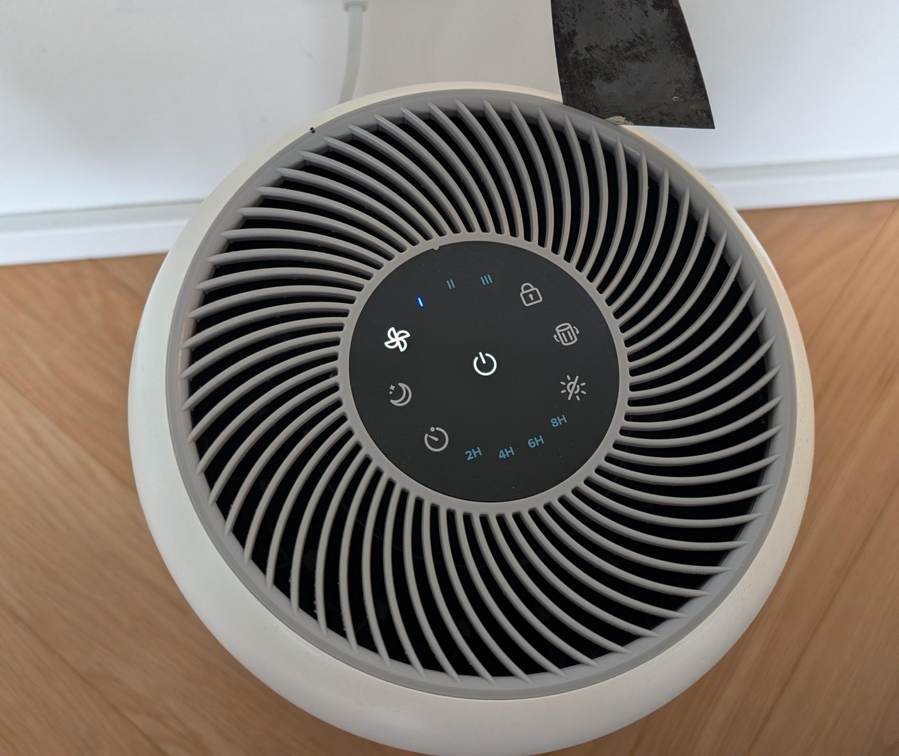
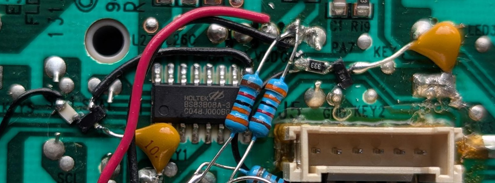
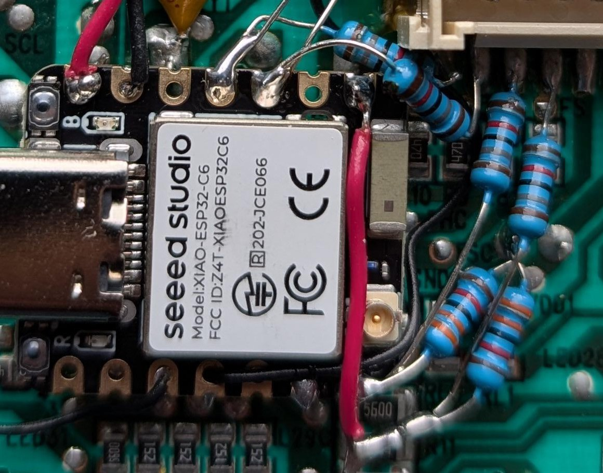
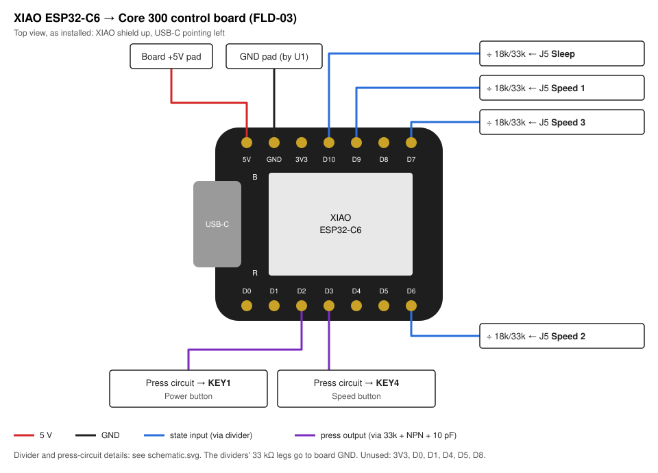
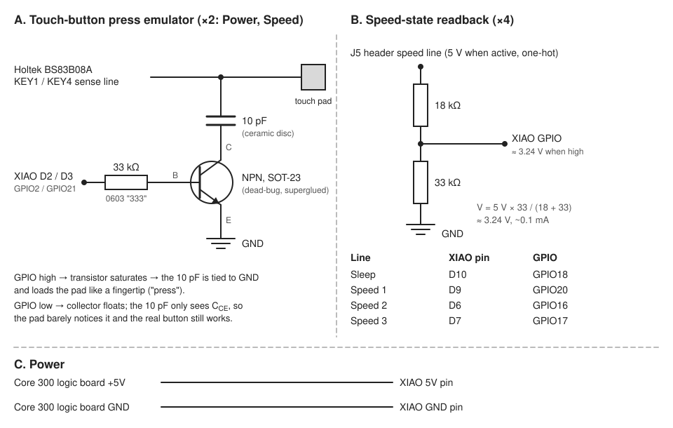

# Levoit Core 300 + ESPHome (XIAO ESP32-C6)

Wi-Fi control for a "dumb" Levoit Core 300 air purifier using a Seeed Studio XIAO ESP32-C6 and [ESPHome](https://esphome.io/), integrated with Home Assistant.

- **Power on/off and speed control from Home Assistant**
- **Live state feedback**: Off / Sleep / Speed 1 / Speed 2 / Speed 3
- **The physical touch buttons keep working.** Nothing on the original board is cut; the ESP32 just "touches" the buttons for you
- Powered from the purifier's own 5 V rail, so no extra power supply is needed

## Getting to the board

You don't have to take the whole purifier apart. The **round top cap pries off**: work a putty knife or flat blade into the seam between the grey top grille and the white housing, then go around the edge. The touch/control PCB (silkscreen `FLD-03`, `E347210`) sits right underneath it.

> ⚠️ Unplug the purifier before working on it. The logic board is on the low-voltage side of the power supply, but the supply itself has mains on it.

## How it works

There are two ways to approach this:

1. **Man-in-the-middle on the touch controller's I2C bus.** The touch buttons are scanned by a Holtek **BS83B08A-3** capacitive-touch MCU, which reports key state over I2C (slave address `0x54`) to the main MCU. The main MCU polls it about 100 times a second. To take this route, the ESP32 would have to act as a full **I2C slave** pretending to be the Holtek chip. ESPHome has no I2C slave mode, so that means custom C++ firmware on the ESP32's historically finicky I2C-slave peripheral instead of a simple YAML config. It's also invasive and timing-sensitive: you'd have to cut SDA and SCL, splice the ESP32 in between, keep up with the host's live transaction timing, and reproduce the `[keystate, ~keystate]` integrity format exactly, or the host rejects every read.
2. **Emulate the button presses.** Make the touch pad think a finger is on it. Not invasive at all, and it's plain ESPHome.

I went with **option 2**.

### Button press emulation

A capacitive touch pad registers a press when the capacitance to ground goes up. Each emulated button uses a tiny NPN common-emitter switch with a **10 pF** capacitor on its collector, wired to the pad's sense node. When the GPIO goes high, the transistor ties the cap to ground, which loads the pad about like a fingertip does. When the GPIO is low, the collector floats and the pad barely sees the extra part.

The capacitance has to be **very low**. A through-hole FET, or even a through-hole BJT, added too much parasitic capacitance and threw off the touch sensing. What worked was **SMD (SOT-23) BC846B NPN transistors**, a **10 pF** ceramic cap on the collector, and a **33 kΩ** base resistor (0603, marked `333`). Everything was hand-soldered, and the SMD transistors are superglued to the board dead-bug style.

Each press is a 500 ms pulse. Don't hold it on: the touch chip keeps recalibrating its baseline, so a "press" that's held down fades away.

Only two buttons are emulated: **Power** on the `KEY1` pad and **Speed** on the `KEY4` pad (speed cycles Speed 1 → 2 → 3 → 1).

*The two SOT-23 transistors with their `333` base resistors and yellow 10 pF caps, next to the Holtek BS83B08A-3.*

### Reading the fan state

The 6-pin header (J5) has **one-hot 5 V logic lines** for Sleep, Speed 1, Speed 2 and Speed 3. Each one goes through a through-hole voltage divider before it reaches the ESP32:

- **18 kΩ** (brown-grey-black-red-brown) on top, **33 kΩ** (orange-orange-black-red-brown) on the bottom
- 5 V × 33 / (18 + 33) ≈ **3.24 V**, well within the C6's 3.3 V logic, with about 0.1 mA of load per line

When none of the lines is high, the unit is off. This reads the fan state directly, so it still works with the display LEDs turned off, which LED sensing wouldn't.

*The four dividers next to J5. The red wire running down the right side of the XIAO carries the Speed 3 line to D7.*

### Power

The XIAO's **5V** pin is connected to the purifier board's **+5V** test point, and its GND to the board's ground. The board has no ground plane and only a few spots where you can reach ground, which was annoying.

Handy for development: with the control board unplugged from the purifier, the XIAO's USB-C port powers both the ESP32 and the control board. You can flash, test the button presses, and watch the logs on the bench.

## Wiring

For the full XIAO ESP32-C6 pinout, see [Seeed's getting-started page](https://wiki.seeedstudio.com/xiao_esp32c6_getting_started/).

| Function | XIAO pin | GPIO | Direction | Board connection |
|---|---|---|---|---|
| Power | 5V | — | — | +5V test pad |
| Ground | GND | — | — | GND test pad next to U1 |
| Power button | D2 | GPIO2 | out | press circuit → `KEY1` |
| Speed button | D3 | GPIO21 | out | press circuit → `KEY4` |
| Sleep state | D10 | GPIO18 | in | divider ← J5 Sleep line |
| Speed 1 state | D9 | GPIO20 | in | divider ← J5 Speed 1 line |
| Speed 2 state | D6 | GPIO16 | in | divider ← J5 Speed 2 line |
| Speed 3 state | D7 | GPIO17 | in | divider ← J5 Speed 3 line |

## Schematic

## Parts

| Qty | Part |
|---|---|
| 1 | Seeed Studio XIAO ESP32-C6 |
| 2 | BC846B NPN BJT, SOT-23 |
| 2 | 10 pF ceramic capacitor |
| 2 | 33 kΩ resistor (0603) |
| 4 | 18 kΩ resistor (through-hole) |
| 4 | 33 kΩ resistor (through-hole) |
| — | Thin hookup wire, superglue, patience |

## Firmware

[`levoit-core300.yaml`](levoit-core300.yaml) is the ESPHome config.

1. Copy `secrets.example.yaml` to `secrets.yaml` and fill it in, or add the keys to your existing ESPHome secrets. Generate the API key with `openssl rand -base64 32`.
2. Flash the XIAO over USB the first time, from the ESPHome Device Builder add-on or with `esphome run levoit-core300.yaml`. Updates after that can go over the air.
3. Add it to Home Assistant. Once it's on your Wi-Fi, Home Assistant should discover it automatically: go to **Settings → Devices & services**, find **ESPHome: Levoit Core 300** under *Discovered*, click **Add**, and paste the `api_encryption_key` from your secrets. If it isn't discovered, click **Add integration → ESPHome** and enter `levoit-core300.local` or the device's IP address.

### Home Assistant entities

| Entity | Type | Notes |
|---|---|---|
| Power | switch | Sends a Power press. Its state comes from the speed lines |
| Speed | select | Speed 1 / 2 / 3. Sends as many Speed presses as needed to get from the current speed to the one you picked |
| Fan speed state | text sensor | Off / Sleep / Speed 1 / Speed 2 / Speed 3 |

From **Sleep**, the first Speed press always goes to Speed 1, and the select logic accounts for that. If the current state is unknown (the unit is off), speed changes are ignored.

## Background: sniffing the touch bus

Before settling on press emulation, I sniffed the I2C traffic between the Holtek touch chip and the main MCU with a Bus Pirate:

- Slave address `0x54` (`0xA8` write / `0xA9` read), polled about 100 times a second
- Read: `[keystate, ~keystate]`, one bit per button, `0x00 0xFF` at idle. Bit 3 is unused
- Write: the host alternates `[A7 58]` and `[A3 5C]`, which looks like a keepalive/poll
- Every payload is sent as a byte followed by its bitwise complement

The final build doesn't use any of this, but it might help anyone who wants to try the MITM approach.

## Disclaimer

This involves opening a mains-powered appliance and will certainly void your warranty. Do it at your own risk.

## License

[CC BY 4.0](LICENSE)
